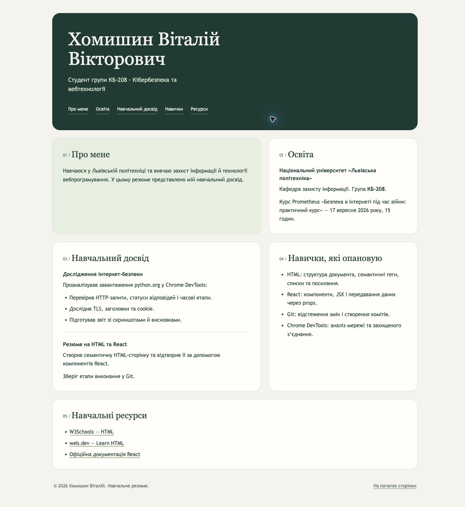

# Responsive Student Portfolio

Адаптивне навчальне резюме у двох реалізаціях: **HTML + CSS** та **React + Tailwind CSS**. Проєкт створено в межах лабораторної роботи з технологій вебпрограмування у Львівській політехніці.



## Що реалізовано

- Семантичні розділи: про мене, освіта, навчальний досвід, навички та ресурси.
- Адаптивна сітка: одна колонка на мобільних пристроях, дві — на ширших екранах.
- Якірна навігація, видимий стан фокуса для клавіатури та підсвічування розділу за посиланням.
- HTML-версія демонструє CSS Grid, Flexbox, медіазапити та різні типи селекторів.
- React-версія складається із семи компонентів; дані передаються через props, список навичок формується з масиву.
- Стилізація React-версії утилітами Tailwind CSS 4.

## Структура

```text
index.html       # HTML-версія
styles.css       # Адаптивні стилі HTML-версії
react/           # React + Vite + Tailwind CSS
  src/App.jsx
  src/components/
preview.png      # Знімок екрана React-версії
```

## Запуск

**HTML/CSS:** відкрийте `index.html` у браузері або запустіть локальний сервер із кореня:

```sh
python3 -m http.server 8000
```

Сторінка буде доступна на <http://localhost:8000>.

**React:** потрібні Node.js 22.12+ або актуальна LTS-версія та npm.

```sh
cd react
npm ci
npm run dev
```

Відкрийте локальну адресу, яку виведе Vite.

## Перевірка та збірка

```sh
cd react
npm run lint
npm run build
npm run preview
```

Це студентський навчальний проєкт: статична презентація досвіду, без серверної частини, реєстрації та збереження даних.

Автор: **Віталій Хомишин**, студент спеціальності «Кібербезпека», група КБ-208.
